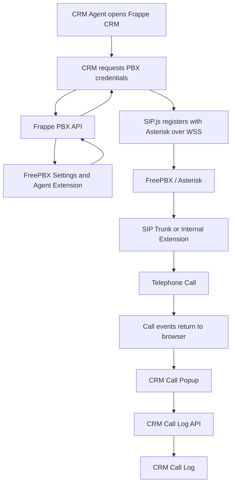

# Frappe PBX
## Native FreePBX / Asterisk Telephony for Frappe CRM

Frappe PBX integrates FreePBX/Asterisk telephony directly into Frappe CRM, allowing CRM agents to make and receive telephone calls from their browser without using a separate desktop or mobile softphone.

It provides browser-based SIP calling using SIP.js and WebRTC over a secure WebSocket connection (WSS).

Agents can:
- Make outbound calls to extensions and external telephone numbers.
- Receive incoming calls directly in Frappe CRM.
- Answer, reject and terminate calls.
- Mute and unmute their microphone.
- View caller information and call duration.
- Add notes to calls.
- Automatically create CRM Call Log records.
- Use their own FreePBX extension and credentials.

The integration uses two applications working together:

1. **Evergro CRM fork (`evergro/crm`)** – contains the browser-based telephone interface and SIP.js integration.
2. **Frappe PBX (`freepbx` app)** – provides the FreePBX configuration, agent credentials, server-side APIs and CRM integration.

Both are required. Installing the PBX app alongside the unmodified upstream Frappe CRM is not sufficient because the browser telephone interface is implemented in the Evergro CRM fork.

---

# 1. Architecture and how it works

Frappe PBX follows a modular architecture. The PBX integration is kept in a separate Frappe application wherever possible, while the CRM fork contains the frontend components required to display and operate the telephone.

### Application responsibilities

| Component | Responsibility |
|---|---|
| Frappe CRM (`evergro/crm`) | Browser telephone interface, SIP.js, call popup and CRM call UI |
| Frappe PBX (`freepbx`) | PBX settings, agent credentials, API endpoints and CRM integration |
| FreePBX / Asterisk | SIP registration, call routing, extensions, trunks and telephone signalling |
| SIP.js | SIP communication between the browser and Asterisk |
| WebRTC | Browser audio and microphone communication |
| CRM Call Log | Stores call information, outcomes and notes |

### How the applications communicate

The following diagram illustrates the relationship between the components.



The browser does not connect directly to the FreePBX administrative interface. Instead, it retrieves the agent's SIP configuration through the Frappe PBX API and registers with Asterisk through its secure WebSocket endpoint.

The PBX handles the actual telephone connection. CRM provides the user interface and records the resulting call activity.

---

# 2. Why the Evergro CRM fork is required

The browser telephone interface is part of the CRM frontend. Frappe CRM uses a compiled Vue application, so simply installing another Frappe application cannot automatically add the complete calling interface to the CRM.

For this reason, the integration uses a modified CRM repository:

**Repository:** `https://github.com/evergro/crm`  
**Branch:** `freepbx`

This branch contains the `crm-freepbx.patch` modifications that introduce the FreePBX calling functionality into the CRM frontend.

The modifications include:
- SIP.js integration.
- Browser SIP user-agent registration.
- WebRTC calling functionality.
- Incoming and outgoing call handling.
- The FreePBX call popup.
- Call controls such as mute, answer, reject and hang up.
- Communication with the Frappe PBX backend.
- CRM Call Log integration.

### Why not use the standard Frappe CRM repository?

The upstream CRM repository does not contain these Evergro-specific frontend modifications.

The separate Frappe PBX application provides the backend functionality, but it cannot independently display the complete telephone interface without the corresponding CRM frontend changes.

**Important:** Use the `freepbx` branch of `evergro/crm`, not the standard upstream CRM repository, when deploying this integration.

---

# 3. What the Frappe PBX application provides

The PBX application owns the functionality that can be maintained independently of the CRM frontend.

### 3.1 FreePBX Settings

A new DocType called **FreePBX Settings** provides the central PBX configuration.

It allows an administrator to configure:

- Whether the integration is enabled.
- PBX domain.
- WebSocket connection URL.
- Default dialing behaviour.
- Country-specific telephone number formatting.
- Outbound number conversion rules.

The WebSocket URL is automatically constructed using the configured PBX domain:

`wss://<pbx-domain>:8089/ws`

For example:

`wss://pbx.example.com:8089/ws`

The PBX administrator does not need to configure individual agents with different PBX server addresses.

### 3.2 CRM Telephony Agent fields

The application extends the existing **CRM Telephony Agent** DocType with additional fields:

- FreePBX Extension.
- FreePBX Extension Password.

Each CRM agent can therefore use their own Asterisk extension.

These fields are added through the Frappe PBX application rather than requiring manual modifications to the CRM core DocTypes.

The extension password is used by the backend to supply the SIP configuration to the authenticated agent.

Treat these credentials as sensitive. Only authorised agents and administrators should have access to them.

### 3.3 Calling medium and call-log integration

The application registers **FreePBX** as an available calling medium in CRM.

It also extends the CRM Call Log medium options to include FreePBX.

This is implemented through Property Setters, which are applied during installation and migration.

As a result, calls made through FreePBX can be recorded in the existing CRM Call Log system rather than requiring a separate call-history application.

### 3.4 Integration status

The Frappe PBX application extends the CRM integration-status response through Frappe's `override_whitelisted_methods` mechanism.

It exposes the `freepbx` integration flag so that the CRM frontend can determine whether FreePBX is enabled.

This allows the CRM interface to activate the calling functionality only when the integration is configured and enabled.

### 3.5 Backend APIs

The application provides backend API endpoints under:

`freepbx.api`

These endpoints handle the server-side communication between CRM and the PBX integration.

They include functionality for:
- Retrieving the authenticated agent's SIP configuration.
- Providing the configured PBX connection details.
- Supporting CRM call-log creation.
- Exposing the integration status to the CRM frontend.

The browser uses these APIs rather than directly reading administrator configuration or accessing the PBX database.

---

# 4. How an agent makes and receives calls

## 4.1 Agent registration

When an agent opens Frappe CRM:

1. The CRM frontend checks whether FreePBX is enabled.
2. It requests the authenticated agent's telephony configuration.
3. Frappe PBX retrieves the agent's assigned extension and PBX settings.
4. The CRM frontend initialises SIP.js.
5. SIP.js connects to Asterisk using the configured WSS endpoint.
6. The agent registers their extension with FreePBX.
7. The browser becomes available to make and receive calls.

Once registration succeeds, the browser console displays:

`Ready to make and receive calls!`

The extension should also appear as registered in Asterisk.

## 4.2 Outgoing calls

When an agent enters a telephone number and initiates a call:

1. CRM validates the dialled number.
2. The frontend applies the configured dialing rules.
3. SIP.js creates an outgoing SIP session.
4. Asterisk receives the call through the registered extension.
5. FreePBX processes the call using its outbound routes.
6. The SIP trunk connects the call to the external telephone network, or Asterisk connects it to another internal extension.
7. SIP.js receives call-progress events.
8. CRM updates the popup to display the call status.

The call popup provides the agent with the controls needed to manage the call.

## 4.3 Incoming calls

When someone calls the agent's extension:

1. FreePBX receives the incoming call.
2. Asterisk routes the call to the registered WebRTC extension.
3. SIP.js receives the incoming INVITE.
4. The CRM frontend identifies the incoming session.
5. The CRM call popup opens.
6. The agent can accept or reject the call.
7. If accepted, the browser establishes the WebRTC audio session.

Incoming caller information can subsequently be matched against CRM records to display the associated Lead, Contact or Customer.

## 4.4 Call completion and logging

When a call ends, the CRM frontend submits the relevant call information to the Frappe PBX backend.

The application creates a CRM Call Log record containing the available call details, including the calling medium and agent-entered notes.

This keeps the telephone activity within CRM's existing call-history functionality.

Call signalling status and actual conversation outcomes are not necessarily the same. For example, an answered call can be answered by voicemail. More advanced answering-machine detection and voicemail classification can be added separately.

---

# 5. Requirements

## 5.1 Software requirements

The integration is designed for:

- Frappe Framework v15.
- ERPNext v15.
- Frappe CRM from the Evergro `freepbx` branch.
- Frappe PBX application.
- FreePBX with Asterisk and PJSIP.
- SIP.js.
- A modern browser supporting WebRTC.

The CRM fork and PBX application must be compatible with the same Frappe v15 bench.

## 5.2 FreePBX requirements

FreePBX must be configured to support WebRTC calling.

The following settings are required for the browser extension:

| Setting | Requirement |
|---|---|
| SIP driver | PJSIP |
| Transport | WebSocket / WSS |
| WebSocket endpoint | TCP 8089 |
| WebRTC | Enabled |
| AVPF | Enabled |
| ICE | Enabled |
| RTCP Multiplexing | Enabled |
| Media encryption | DTLS-SRTP |
| DTLS certificate | Valid certificate for the PBX domain |
| RTP | UDP ports 10000–20000 |
| External media address | Correct public IP configuration |
| ICE host candidates | Correct private/public address mapping |

The PBX must also have:
- At least one configured WebRTC extension per agent.
- A working outbound route for external calls.
- A configured SIP trunk for external telephone numbers.
- Appropriate inbound routes for receiving external calls.

Internal extension-to-extension calls do not require a SIP trunk.

## 5.3 Browser requirements

The browser must be able to access the CRM website and PBX WebSocket endpoint.

Microphone access requires a secure browser context.

Normally, this means:
- HTTPS for the CRM website.
- Valid WSS certificate for the PBX.
- Browser microphone permissions.
- Network access to the required RTP ports.

For local development, browsers generally treat `localhost` as a secure context. An insecure development hostname such as `http://evergro.local` may not allow microphone access.

---

# 6. Installation

The following instructions describe a new development installation using Frappe v15.

**Important:** Back up your site and existing applications before changing the CRM repository. Do not replace a working custom CRM fork without first preserving its changes.

## Step 1: Open the bench

```bash
cd ~/frappe-bench
```

Confirm the bench versions:

```bash
bench version
```

Confirm the target site:

```bash
bench --site your-site.local list-apps
```

Replace `your-site.local` with the actual site name.

## Step 2: Install the Evergro CRM fork

For a fresh installation:

```bash
bench get-app https://github.com/evergro/crm --branch freepbx
```

Install CRM on the target site:

```bash
bench --site your-site.local install-app crm
```

This installs the modified CRM application containing the browser calling interface.

If CRM is already installed, do not run `get-app` blindly. Verify that the existing `apps/crm` repository points to `evergro/crm` and that the active branch is `freepbx`.

## Step 3: Obtain the Frappe PBX application

The PBX application must be available inside the bench's `apps` directory.

If cloning the application directly:

```bash
cd ~/frappe-bench

git clone https://github.com/evergro/frappe_pbx apps/freepbx
```

The repository URL above should be replaced with the actual published repository URL if the project is hosted under a different name.

Check that Frappe recognises the application:

```bash
bench list-apps
```

**Application naming:** The project may be referred to as Frappe PBX or `frappe_pbx`, while the installed Frappe app name in the current implementation is `freepbx`. Use the actual `app_name` declared in the application's `hooks.py` and `modules.txt` when installing it.

## Step 4: Install the PBX application

```bash
bench --site your-site.local install-app freepbx
```

This adds the PBX configuration, agent fields, property setters and backend integration.

## Step 5: Run migrations

```bash
bench --site your-site.local migrate
```

Migration applies the required schema and property-setter changes.

## Step 6: Build the CRM frontend

The CRM calling interface is compiled into the CRM frontend, so rebuild CRM after installing the PBX application.

```bash
bench build --app crm
```

Restart the bench:

```bash
bench restart
```

Reload the CRM website in the browser.

### Build troubleshooting

If the CRM build fails with:

`Could not load ../../frappe/ui/src`

Check the Frappe v15 repository and its frontend dependencies before rebuilding.

For a normal Git-based installation:

```bash
cd ~/frappe-bench/apps/frappe
git status
```

If there are no local changes and the repository is on the intended v15 branch, update it using the appropriate project maintenance procedure.

Do not blindly pull or reset a customised Frappe installation.

Then rebuild:

```bash
cd ~/frappe-bench
bench build --app crm
```

---

# 7. Configuration

After installation, configure the PBX connection and agent extensions.

## Step 1: Configure FreePBX Settings

Open the Frappe Desk.

Search for:

**FreePBX Settings**

Configure the following:

| Field | Example |
|---|---|
| Enabled | Checked |
| PBX Domain | `pbx.example.com` |
| WebSocket URL | `wss://pbx.example.com:8089/ws` |

The WebSocket URL is normally generated automatically from the PBX domain.

Review the dialing rules to ensure that telephone numbers are converted correctly for your country.

For example, a South African number in international format:

`+27821234567`

May need to be converted to:

`0821234567`

The exact conversion depends on the outbound route and the number format expected by the SIP trunk.

Save the settings.

## Step 2: Configure CRM Telephony Agent

Navigate to:

**CRM → Settings → Telephony**

Alternatively, open the CRM Telephony Agent DocType from Desk.

For each agent, configure:

| Field | Example |
|---|---|
| Agent | John Smith |
| FreePBX Extension | 305 |
| FreePBX Extension Password | The extension's SIP secret |
| Default Medium | FreePBX |

The extension and password must match the corresponding WebRTC-enabled PJSIP extension in FreePBX.

Each agent should have their own extension and credentials.

Do not share one SIP extension across multiple agents. Multiple browser registrations for the same extension can cause registration conflicts and unpredictable call behaviour.

Save the agent configuration.

## Step 3: Reload CRM

Log out and back in, or reload the CRM frontend.

The agent's browser should now initialise the SIP.js user agent and register the configured extension.

The browser may request microphone permission when the agent first initiates a call.

---

# 8. Testing

Before using the integration in production, complete the following tests.

## 8.1 Confirm SIP registration

Open the Asterisk CLI:

```bash
asterisk -rvvv
```

Run:

```asterisk
pjsip show contacts
```

Confirm that the agent's extension appears as registered over WebSocket.

In the CRM browser console, check for:

`Ready to make and receive calls!`

## 8.2 Test an internal call

1. Log in to CRM as an agent.
2. Confirm the agent's extension is registered.
3. Dial another internal extension, for example `302`.
4. Confirm that the CRM popup displays the outgoing call.
5. Confirm the status changes from Calling to Ringing.
6. Answer from extension 302.
7. Confirm the call timer starts.
8. Test mute and unmute.
9. Add a call note.
10. Hang up.

Check that a CRM Call Log record is created with the FreePBX medium and the entered note.

## 8.3 Test an incoming call

1. Use another registered phone to call the agent's extension.
2. Confirm that the CRM popup appears.
3. Confirm that the agent can see the incoming call.
4. Accept the call.
5. Verify two-way audio.
6. Hang up.
7. Confirm the call log.

## 8.4 Test call outcomes

Test the following scenarios:

| Scenario | Expected behaviour |
|---|---|
| Outgoing call answered | Connected call and call log |
| Outgoing call not answered | No Answer outcome |
| Outgoing call cancelled by agent | Canceled outcome |
| Incoming call accepted | Connected call |
| Incoming call rejected | Rejected or appropriate call outcome |
| Incoming call missed | No Answer outcome |
| Internal extension call | Successful two-way audio |
| External SIP trunk call | Successful two-way audio |

The exact stored status depends on the CRM call-event handling and the session termination reason.

---

# 9. Troubleshooting

## No FreePBX option in CRM

Check:
- FreePBX Settings is enabled.
- The PBX application is installed.
- `bench migrate` has completed successfully.
- The CRM frontend has been rebuilt.
- The browser has been refreshed.

Commands:

```bash
bench --site your-site.local list-apps
bench --site your-site.local migrate
bench build --app crm
bench restart
```

## Browser does not request microphone permission

Microphone access requires HTTPS or a browser-recognised secure context.

For local development, use localhost where possible.

If the CRM website is accessed through an insecure custom hostname, Chrome may block microphone access.

Do not use insecure-origin browser flags as a production solution.

## SIP registration fails

Check:
- Extension number.
- SIP password.
- PBX domain.
- WebSocket endpoint.
- WSS certificate validity.
- WebRTC settings on the PJSIP extension.

Use the browser developer console and Asterisk CLI.

```bash
asterisk -rvvv
```

Then:

```asterisk
pjsip set logger on
```

An authentication failure may appear as SIP `401` or `403` responses.

Disable SIP logging after troubleshooting:

```asterisk
pjsip set logger off
```

## One-way audio or no audio

Check:
- UDP RTP ports 10000–20000.
- Firewall rules.
- Asterisk external media address.
- ICE host candidate configuration.
- DTLS-SRTP configuration.
- WebRTC extension settings.
- Browser microphone permissions.

Also check that the browser can reach the PBX WSS endpoint.

A successful SIP registration does not guarantee that RTP audio is working.

## Calls connect but no audio

A SIP `200 OK` response indicates that the call has been answered at the signalling level. It does not prove that media is flowing.

Enable RTP debugging:

```asterisk
rtp set debug on
```

Compare a successful call against a silent call.

Check whether RTP packets are being sent and received.

Disable debugging afterwards:

```asterisk
rtp set debug off
```

## Calls are not recorded in CRM

Check:
- The CRM Call Log API response.
- Browser console errors.
- Backend application logs.
- Whether the authenticated agent has permission to create or update the relevant call records.
- Whether FreePBX is available as a calling medium.

---

# 10. Security and operational recommendations

For production deployments:

1. Always use HTTPS for CRM and WSS for the PBX connection.
2. Use valid TLS certificates.
3. Assign a unique PJSIP extension to each agent.
4. Protect extension passwords and avoid exposing credentials in browser logs.
5. Restrict access to FreePBX Settings and agent credential fields.
6. Restrict the PBX administrative interface to authorised administrators.
7. Allow only the necessary SIP, WSS and RTP traffic through the firewall.
8. Keep Frappe, ERPNext, CRM and the PBX application on compatible, tested versions.
9. Back up the site and application configuration before updating.
10. Test inbound, outbound and audio functionality after every major upgrade.

For security, the browser must receive only the SIP configuration needed by the authenticated agent. Administrator credentials and PBX management credentials must never be exposed through the frontend.

---

# 11. Development and maintenance

Frappe PBX is designed to keep the majority of the integration outside the CRM codebase.

The CRM fork contains the frontend modifications required to run SIP.js and display the calling interface.

The separate PBX application handles:
- PBX configuration.
- Agent extension fields.
- Integration status.
- CRM calling-medium registration.
- Server-side API functionality.
- Property Setter installation and migration.

This separation reduces the amount of CRM core functionality that needs to be modified.

### Updating the applications

Update the applications carefully and keep their versions compatible.

For the PBX application:

```bash
cd ~/frappe-bench/apps/freepbx
git status
git pull
```

For the CRM fork:

```bash
cd ~/frappe-bench/apps/crm
git status
git branch --show-current
```

Confirm that the active branch is `freepbx` before updating.

After updating:

```bash
cd ~/frappe-bench

bench --site your-site.local migrate
bench build --app crm
bench restart
```

Do not switch the CRM repository back to the upstream Frappe CRM branch unless the FreePBX frontend modifications have been incorporated into another compatible branch.

### Important maintenance principle

Keep the FreePBX backend functionality in the separate PBX application wherever possible.

Only modify the CRM frontend when the integration requires changes to the compiled CRM user interface or its existing call-handling components.

This makes it easier to maintain the PBX application independently and reduces the risk of losing custom functionality when updating CRM.

---

# 12. Current implementation scope and future development

The working implementation provides native browser calling, agent registration, incoming and outgoing calls, call controls and CRM Call Log integration.

The following are possible future enhancements and should not be confused with functionality already guaranteed by the current implementation:

- Caller identification against ERPNext Customers and Contacts.
- Automatic voicemail and answering-machine detection using Asterisk AMD.
- Advanced call queues and agent availability.
- Call recording and recording playback.
- Call transfers and hold functionality.
- Multi-agent presence and extension monitoring.
- Detailed call analytics and reporting.
- Integration with Frappe Helpdesk.
- Automatic ticket creation from missed calls.
- Customer communication history across phone, WhatsApp and email.

These can be developed incrementally without changing the fundamental architecture.

---

# 13. Project summary

Frappe PBX brings FreePBX/Asterisk telephone functionality into Frappe CRM through SIP.js and WebRTC.

It consists of two essential software components:

**1. Evergro CRM fork**
- Repository: `evergro/crm`
- Branch: `freepbx`
- Contains the SIP.js integration and browser calling interface.

**2. Frappe PBX application**
- Installed Frappe app name: `freepbx` (verify the actual app name in the repository).
- Contains PBX settings, agent configuration, APIs and CRM integration.

FreePBX/Asterisk remains responsible for telephone services, SIP registration, routing and media. Frappe CRM provides the interface through which agents make and receive calls. Frappe PBX connects the two.

**The key installation requirement is that the PBX application and the Evergro CRM fork must be used together. The standard upstream Frappe CRM does not contain the frontend modifications required for this integration.**

The result is a browser-based telephone system integrated directly into the CRM workflow, with calls and agent activity recorded in CRM rather than managed in a separate softphone application.
